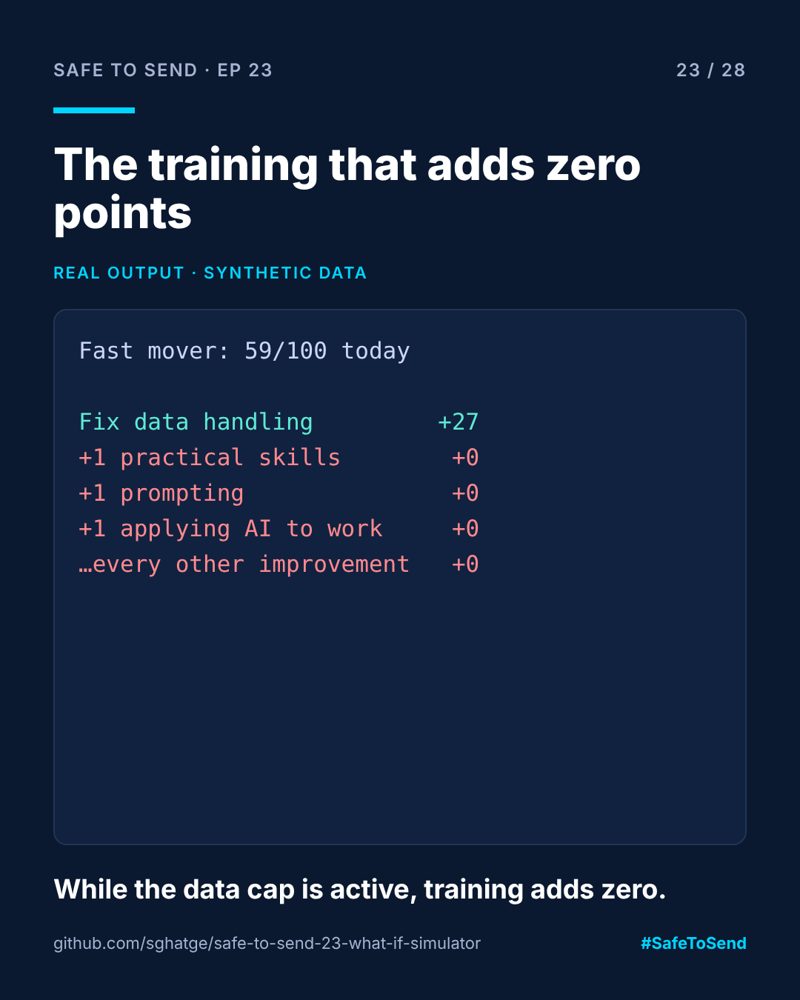

# safe-to-send-23 · What-If Simulator



**Safe to Send · Episode 23** — a 28-day learn-in-public series on governing AI in CRM operations.

> In my readiness model, one answer can cap a whole team at 59. This tool shows what that means for your training budget.

## The real-world scenario

A team scores 59 on AI readiness. The manager books a prompt-engineering course for everyone. Next quarter they score 59 again. The problem was never skills: one data-handling risk flag caps the score, and no amount of training moves it until that's fixed.

## Run it

```bash
python whatif.py examples/profiles.json "Fast mover, loose guardrails"
python whatif.py examples/profiles.json "Blocked enthusiast"
```

## Real example output

```
Fast mover, loose guardrails: 59/100 today

  +27  Fix data handling (clear flag, +2 on privacy)
   +0  +1 on Role and use-case fit
   +0  +1 on Prompting and verification
   +0  +1 on Practical AI skills
   +0  +1 on Data privacy and responsible AI
   ...  (every other improvement: +0)

Blocked enthusiast: 54/100 today

   +3  +1 on Data privacy and responsible AI
   +2  +1 on Role and use-case fit
   +2  +1 on Prompting and verification
   ...
```

Each line is the change in the final score from one improvement.

## Why this matters

With the cap active, ten of the eleven possible improvements, including the prompt-engineering course, add **0** points. Fixing data handling is the only move that counts, and it unlocks everything else.

For the "blocked enthusiast" profile the picture is completely different: no cap, and every improvement is worth 1 to 3 points. There is no single lever; that team needs steady, broad progress. Same model, different team, different strategy. That's why the what-if belongs next to the score, not in a separate slide.

## Files

- `readiness.py` — the scoring model (same as [safe-to-send-22](https://github.com/sghatge/safe-to-send-22-readiness-score))
- `whatif.py` — the simulator

MIT · [Sangram Ghatge](https://www.linkedin.com/in/sangram-g-2369705b) · #SafeToSend
